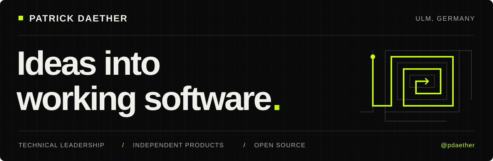
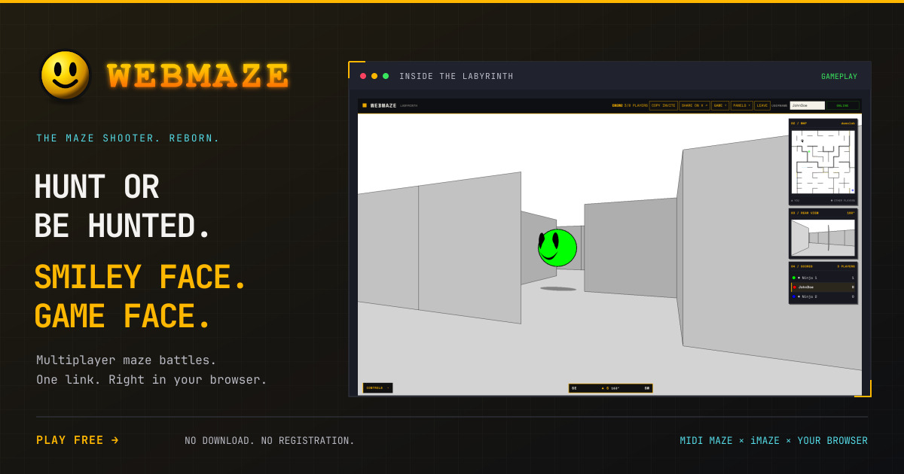

  

  <a href="https://www.shuttlework.com/"><strong>shuttlework ↗</strong></a> &nbsp; / &nbsp;
  <a href="https://webmaze.shuttlework.com/">Play WebMaze</a> &nbsp; / &nbsp;
  <a href="https://www.linkedin.com/in/pdaether/">LinkedIn</a> &nbsp; / &nbsp;
  <a href="https://x.com/pdaether">X · @pdaether</a>

# Hi, I'm Patrick.

**Technical Director & Authorized Signatory at [zeroseven](https://www.zeroseven.de/). Independent maker behind [shuttlework](https://www.shuttlework.com/). Based in Ulm, Germany.**

I help businesses turn complex requirements into clear architecture and dependable web applications. I lead engineering, stay close to the code, and build products and tools that make everyday work better.

## From architecture to production

- **Technical leadership & consulting** — connect business goals with engineering decisions, give teams direction, and turn an ambitious brief into a practical plan.
- **Web development & software architecture** — build maintainable applications, useful integrations, and systems that can evolve with the business.
- **Engineering & operations** — carry the work through testing, deployment, monitoring, and the realities of running software.

## shuttlework · my independent software studio

**[We shuttle ideas into production.](https://www.shuttlework.com/)**

shuttlework is where I build my own products, from the first sketch to the running system. Product strategy, design, development, and operations belong together. Small scope, frequent releases, and ownership beyond launch.

I use AI to accelerate the work, with human review and testing keeping the quality bar in place.

### WebMaze · multiplayer nostalgia, one browser tab away

My homage to **MIDI Maze and iMaze**: smiley-faced opponents, 3D labyrinths, and multiplayer battles you can share with a single link. **No download. No registration.**

My first computer was an Atari 520 ST. Playing MIDI Maze with friends over actual MIDI cables felt like the future; later, iMaze kept us in university computer labs long into the night. WebMaze brings that joy to the browser.

**[Enter the maze →](https://webmaze.shuttlework.com/)** · Bring a friend or challenge the Ninjas.

## Open source, built for everyday use

I publish tools that solve problems I run into myself — in the browser, the terminal, and the Linux desktop.

- **[ploi-tui](https://github.com/pdaether/ploi-tui)** · Go / Bubble Tea 
  Ploi servers, sites, monitoring, certificates, and SSH — all from the terminal.

- **[BlockWire](https://github.com/pdaether/blockwire)** · Laravel / Livewire / Alpine.js / Tailwind CSS 
  A reactive drag-and-drop content editor for the TALL stack, continuing Jeffrey van Rossum's DropBlockEditor.

- **[Ploi Panel](https://github.com/pdaether/omarchy-ploi)** & **[Creem Pulse](https://github.com/pdaether/omarchy-creemio-panel)** · QML / JavaScript 
  Server health and SaaS revenue at a glance, directly in the Omarchy bar.

- **[oh-my-chy](https://github.com/pdaether/oh-my-chy)** · Shell / Linux 
  A repeatable setup that turns a fresh Omarchy install into my development environment.

- **[pest.nvim](https://github.com/pdaether/pest.nvim)** · Lua / Neovim 
  PHP Pest tests inside the editor, with live results.

**[Explore my public repositories →](https://github.com/pdaether?tab=repositories)**

## Let's build something useful.

Have an engineering challenge or want to exchange ideas? **[Connect with me on LinkedIn](https://www.linkedin.com/in/pdaether/).**

Interested in shuttlework products or a partnership? **[Say hello →](mailto:hello@shuttlework.com)**

Building in public on <a href="https://x.com/pdaether">X</a>. Also into motorcycles, HYROX, and making Linux feel like home.
